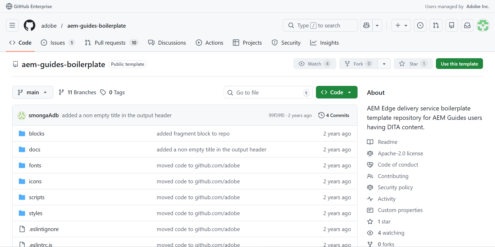
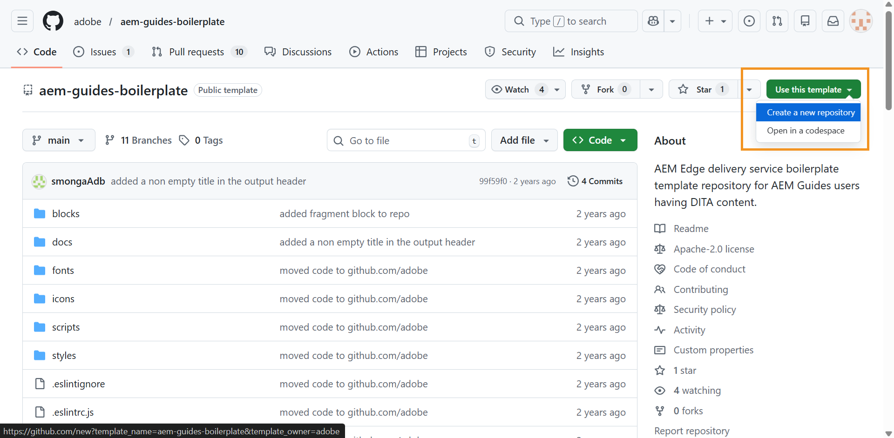
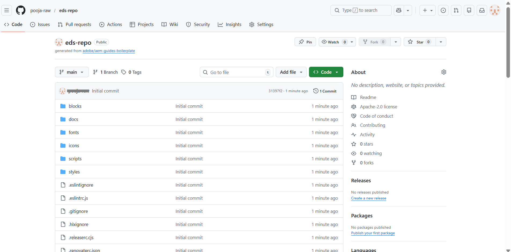
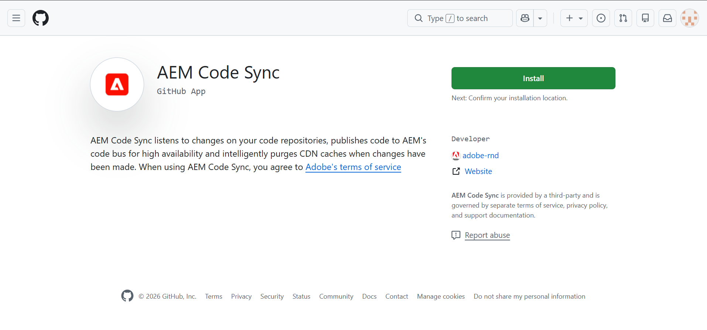
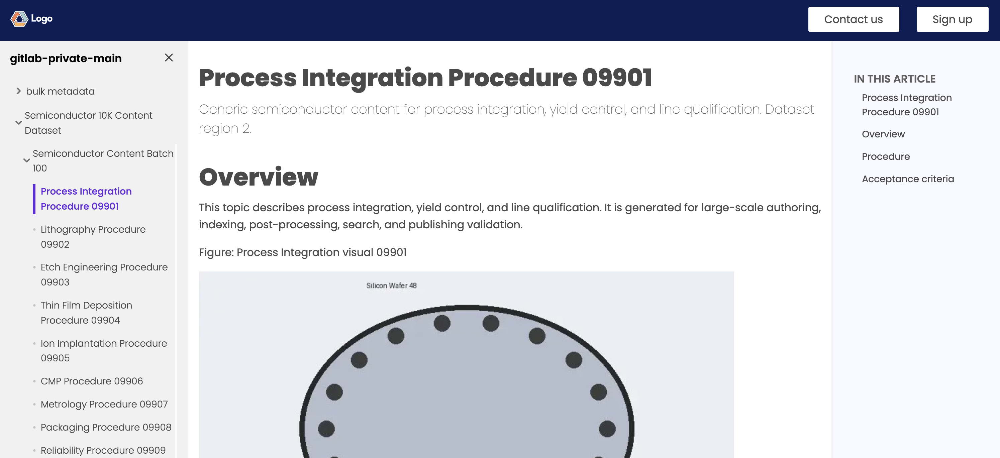
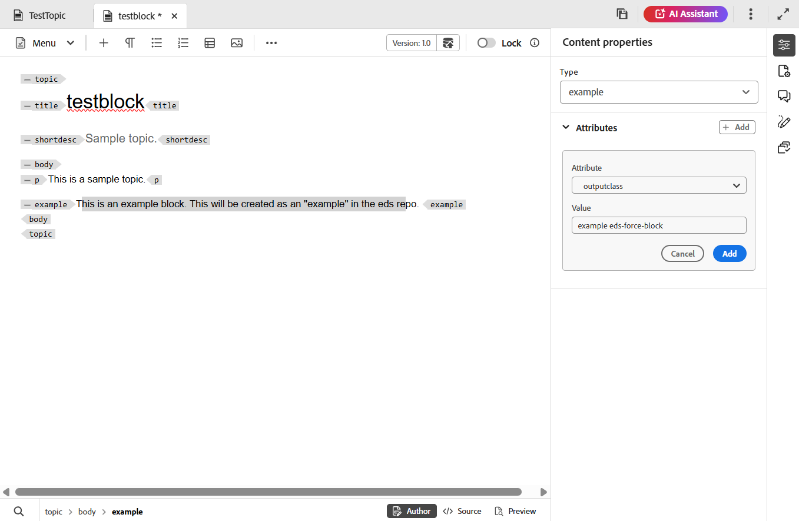

# Experience Manager GuidesとEdge Delivery Services

Adobe Experience Manager Guidesでは、専用のGitHub ベースのパブリッシュプロファイルを使用して、DITA コンテンツをEdge Delivery Services（EDS）に直接公開できます。 この機能により、Experience Manager GuidesのDITA ベースのオーサリングワークフローを維持しながら、高性能でレスポンシブなドキュメント体験を提供することができます。

Adobe Experience ManagerでのEDSの使用について詳しくは、[Edge Delivery Servicesの概要](https://experienceleague.adobe.com/ja/docs/experience-manager-cloud-service/content/edge-delivery/overview)を参照してください。

Experience Manager GuidesからEDSへの公開を有効にするには、GitHubとExperience Manager Guidesの一連の設定手順を完了する必要があります。 以下のセクションでは、各ステップを順番に説明し、公開ワークフロー全体でどのように連携するかを説明します。

1. [EDS用にGitHubをセットアップして設定する](#set-up-and-configure-github-for-eds)
2. [Experience Manager GuidesでのEDS用のパブリッシュプロファイルの作成と設定](#create-and-configure-a-publish-profile-for-eds-in-experience-manager)
3. [EDS ブロックを使用した出力のカスタマイズ](#customize-output-using-eds-blocks)

簡単なビデオのチュートリアルについては、[AEM Guidesでの公開](https://experienceleague.adobe.com/en/docs/experience-manager-guides/using/knowledge-base/expert-session/publishing-in-aem-guides-aug25)をご覧ください。


## EDS用にGitHubをセットアップして設定する

この節では、EDSで使用するためのGitHubの設定と設定方法について説明します。 Adobeのボイラープレートを使用したリポジトリの作成、AEM Code Syncを介したGitHubとAdobe Experience Managerの接続、必要なGitHubおよびOAuth アプリケーションの設定、コンテンツの公開に使用するリポジトリのマウントポイントの定義について説明します。

### EDS用のGitHub リポジトリの作成

EDSには、事前定義された構造を持つGitHub リポジトリが必要です。 Adobeでは、Experience Manager Guides ユーザー向けに設計された公式の定型リポジトリを提供しています。

リポジトリを作成するには、次の手順を実行します。

1. Experience Manager Guides ボイラープレートテンプレートリポジトリ [aem-guides-boilerplate](https://github.com/adobe/aem-guides-boilerplate)を開きます。
   

2. このテンプレートを使用して新しいリポジトリを作成します。 テンプレート ](https://docs.github.com/en/repositories/creating-and-managing-repositories/creating-a-repository-from-a-template)からリポジトリを作成する[について説明します。 リポジトリの表示が&#x200B;*パブリック*&#x200B;に設定されていることを確認し、EDSがアクセスできるようにします。

   

リポジトリが作成され、ボイラープレートのテンプレート構造と整合します。



### 新しいOAuth アプリの作成

Experience Manager GuidesでEDS公開プロファイルを作成する際にユーザーを認証するには、OAuth アプリが必要です。 *クライアント ID*&#x200B;と&#x200B;*クライアントシークレット*&#x200B;を使用して、セキュアなログインフローを有効にします。

新しいOAuth アプリを作成するには、次の手順を実行します。

1. GitHubで、左側のサイドバーに移動し、**開発者設定**&#x200B;を選択します。
2. 左側のサイドバーで、**OAuth Apps**&#x200B;を選択します。
3. **新規OAuth アプリ**&#x200B;を選択します。

   {width="650"}

4. 次の必須の詳細を指定して、アプリケーションを登録します。

   - **アプリケーション名**: EDS リポジトリの名前を入力します
   - **ホームページ URL**: Experience Manager Guides インスタンスのURLを入力します。 （URL形式のサンプルについては、[新しいGitHub アプリの作成](#create-a-new-github-app) セクションの手順4を参照してください）。
   - **認証コールバック URL**: ホームページ URLと同じ

5. 「**デバイスフローを有効にする**」オプションを選択し、「**アプリケーションを登録**」を選択して登録を完了します。

   {width="650"}

これでアプリの準備ができました。 *クライアント ID*&#x200B;をメモします。 Experience Manager Guidesで公開プロファイルを設定する際に、最大5つの&#x200B;*クライアントシークレット*&#x200B;を生成できます。


### EDS リポジトリでのマウントポイント URLの設定

EDSは、リポジトリのルートにある`fstab.yaml` ファイルで定義された&#x200B;*mountpoint* URLからコンテンツを読み取ります。 このURLは、生成されたコンテンツをExperience Manager Guidesが公開する場所をEDSに示します。

`fstab.yaml` ファイルでマウントポイント URLを設定するには：

1. GitHub リポジトリで、`fstab.yaml` ファイルを開きます。
2. 次の形式を使用して`url`値を更新します。

   ```text
   https://guides.adobe.com/eds-workers/<account type>/<git acc domain>/<git username>/<git repo>/<branch>/<root folder>
   ```

   次の表に、URLの各フィールドを示します。

   | フィールド | 説明 |
   |---|---|
   | `https://guides.adobe.com/eds-workers` | Experience Manager GuidesがコンテンツをEDSに公開するために使用するワーカーURL。 この値は変更しないでください。 |
   | `<account type>` | Git アカウントのタイプ。 `github` に設定します。 |
   | `<git acc domain>` | Git アカウントのドメイン。 `github.com` に設定します。 |
   | `<git username>` | GitHub ユーザー名。 |
   | `<git repo>` | EDS用に作成したGitHub リポジトリの名前。 |
   | `<branch>` | コンテンツを公開するブランチ。 デフォルト値は `main` です。 GitHubでブランチ名を変更した場合は、ここで更新し、Experience Manager GuidesのEDS パブリッシュプロファイルで更新します。 |
   | `<root folder>` | 公開されたファイルがコミットされるリポジトリのルートフォルダー。 デフォルト値は `docs` です。 GitHubでフォルダー名を変更した場合は、ここで更新し、Experience Manager GuidesのEDS パブリッシュプロファイルで更新します。 |

   例えば、GitHub ユーザー名が`my-username`、リポジトリ名が`my-eds-repo`の場合、`fstab.yaml` ファイルは次のように表示されます。

   ```yaml
   mountpoints:
     /:
       url: https://guides.adobe.com/eds-workers/github/github.com/my-username/my-eds-repo/main/docs
       type: markup
   ```

   {width="650"}

   >[!NOTE]
   >
   > 以前のURL形式（`https://guides.adobe.com/eds-workers/<git username>/<git repo>/<branch>/<root folder>`）を引き続き使用する場合、アカウントタイプとドメインはデフォルトで`github`と`github.com`になります。

3. リポジトリを認証するには、「[AEM Code Sync](#connect-github-to-adobe-via-aem-code-sync)経由でGitHubをAdobeに接続」セクションの手順2と3を繰り返します。

### AEM Code Syncを介してGitHubをAdobeに接続する

Adobe Experience Managerは、**AEM Code Sync**&#x200B;というGitHub アプリケーションを使用して、Experience Manager GuidesからGitHubにコンテンツをプッシュします。

次の手順を実行して、*AEM Code Sync* アプリケーションをインストールおよび設定します。

1. [AEM Code Sync](https://github.com/apps/aem-code-sync) ページに移動し、**インストール**&#x200B;を選択します。

   **AEM Code Sync**&#x200B;は、リポジトリの変更を監視し、更新がGitHubに正しくプッシュされるようにします。

   >[!NOTE]
   >
   >アプリケーションのインストール中は、リポジトリを所有する同じGitHub アカウントを使用していることを確認してください。

   

2. 次のページで、作成したリポジトリへのアクセス権を付与します。 「**リポジトリのみを選択**」を選択し、ドロップダウンからリポジトリを選択します。

   {width="350"}

3. 「**インストールして承認**」を選択します。

   GitHub設定ページにリダイレクトされます。

   

4. ソースコードの詳細を確認し、**次へ**&#x200B;を選択してください。

5. **コンテンツソース** ページで、次の設定を行います。

   - **コンテンツ ソースの種類：** **その他（独自のマークアップを取り込む）**&#x200B;を選択します。
   - **コンテンツソース URL:** `fstab.yaml` ファイルでマウントポイント URLとして設定されたURLを確認します。 ファイル内のURLを更新していない場合は、ここで更新できます。
   - **ファイル拡張子：** デフォルトの`.html`接尾辞を`.htm`に変更します。

   **別のコンテンツソースを使用**&#x200B;が選択されていることを確認します。

6. **ユーザー** ページで、必要に応じてユーザーを追加し、**次へ**&#x200B;を選択します。

7. 設定の概要を確認し、**保存**&#x200B;を選択します。

   登録が成功すると、確認ページが表示されます。 このページから、web サイトの&#x200B;**プレビュー**&#x200B;および&#x200B;**ライブ**&#x200B;のURLをコピーして保存できます。

   

## EDS用にGitLabをセットアップして設定する

GitLabをEdge Delivery Servicesの公開リポジトリとして設定する手順については、[EDS](./configure-eds-gitlab.md)のGitLabの設定と設定を参照してください。

## Experience ManagerでのEDS用のパブリッシュプロファイルの作成と設定

以下の節では、各ステップを順番に説明し、EDS パブリッシュプロファイルの設定、出力プリセットの設定、およびExperience Manager GuidesでのEDSを使用した出力の生成方法について説明します。

### GitHubまたはGitLab用のEDS パブリッシュプロファイルの作成

1. **[Workspace settings](/help/product-guide/cs-install-guide/workspace-settings.md)** **>** **プロファイルの公開**&#x200B;に移動します。
2. **+** アイコンを選択して、新しい公開プロファイルを作成し、次の詳細を指定します。

   - **Server type\*:** ドロップダウンから「**Git （Edge Delivery Service）**」を選択します。
   - **名前\*:**&#x200B;公開プロファイルの名前を入力します。
   - **Git アカウントの種類\*:** Git リポジトリ プロバイダーに応じて、ドロップダウンから&#x200B;**GitHub**&#x200B;または&#x200B;**GitLab**&#x200B;を選択します。
   - **インスタンス URL\*:** GitHubまたはGitLab インスタンスのURL （例：`https://github.com`または`https://gitlab.com`）を入力します。
   - **リポジトリ名\*:** GitHubまたはGitLab リポジトリの名前を入力します。
   - **ユーザー名\*:** GitHubまたはGitLabのユーザー名を入力します。
   - **分岐名：**&#x200B;を`main`に設定しました（デフォルト）。
   - **ルートフォルダー\*:**&#x200B;を`docs`に設定（デフォルト）。
   - **サイト所有者（*GitLabのみ*）:** Edge Delivery Services サイトの所有者を入力します。
   - **サイトリポジトリ （*GitLabのみ*）:** Edge Delivery Services サイトに関連付けられているリポジトリ名を入力します。
   - **HLX API キー：** EDS設定のHLX API キーを入力します。 このキーは、Experience Manager Guides as a Cloud Serviceの2026.11.0 リリースで導入された非公開機能をサポートするために必要です。 また、コンテンツサイズが100個を超える場合は、コンテンツをEDSに公開するためにキーが必要です。
   - **認証資格情報：**&#x200B;選択したGit アカウントの種類に基づいて資格情報を指定します：
     - **GitHub:** GitHub OAuth アプリから取得した&#x200B;**クライアント ID\***と&#x200B;**クライアントシークレット\***を入力します。 詳しくは、[新しいOAuth アプリの作成](#create-a-new-oauth-app)を参照してください。
     - **GitLab:** GitLab アカウント用に生成された&#x200B;**アクセストークン\***を入力します。
3. （*GitHubのみ*）認証する&#x200B;**ログイン**&#x200B;を選択します。 GitLabの場合、アクセストークンは認証に使用されるため、ログインは必要ありません。

   {width="650"}

4. 「**保存**」を選択します。 GitHubの場合、認証が成功すると、**保存** オプションが使用できます。

これで、EDS公開プロファイルが設定されました。

### EDS用の出力プリセットの作成と出力の生成

1. マップコンソールでマップを開きます。
2. **出力プリセット** タブで、**+**&#x200B;を選択して、新しい出力プリセットを作成します。
3. **新しい出力プリセット** ダイアログで、次の詳細を入力します。
   - **種類**: **Edge Delivery サービス**&#x200B;を選択
   - **名前**：このプリセットの名前を指定します
4. 「**追加**」を選択します。

   {width="650"}
5. 新しく作成したEDS出力プリセットを開き、次のフィールドを設定します。

   - **条件付きフィルタリング：** **なし**&#x200B;を選択してフィルタリングせずに出力を生成するか、**DITAVAL**&#x200B;を使用して条件付きフィルタリングを適用します。
   - **サブフォルダーを公開：**&#x200B;出力が公開されるサブフォルダーの名前を入力します。 サブフォルダーはルートフォルダーの下のリポジトリーに作成され、その名前は公開されたコンテンツへのEDS リンクに表示されます。 例えば、ルートフォルダーが`docs`、公開サブフォルダーが`product-guide`の場合、コンテンツは`docs/contents/product-guide`に公開されます。
   - **公開プロファイル：**&#x200B;前のセクションで設定したGitHubまたはGitLab公開プロファイルを選択します。

     {width="650"}

6. 「**保存**」を選択し、「**出力を生成**」を選択します。

>[!NOTE]
>
>生成された出力は、EDS リポジトリの`<root folder>/contents/<publish subfolder>` フォルダーに保存されます。

これで、EDS出力が生成されました。 コンテンツはレスポンシブでクリーンなレイアウトで表示されます。 ページタイトル、パンくずリスト、本文、トピックで使用されるすべてのブロックなどの通常の要素が含まれます。 左側の目次（マップから生成）は、トピック間を移動するのに役立ちます。右側のミニ目次は、現在のページ内のセクションをハイライト表示します。 出力全体が完全にレスポンシブになり、デバイス間で最適化された一貫性のある読み取りエクスペリエンスを実現します。

>[!NOTE]
>
> 同じweb サイトに複数のDITA マップを公開できます。 公開されたマップは左側のナビゲーションパネルに表示され、各マップからコンテンツにアクセスできます。 新しいマップを公開しても、以前に公開したマップは上書きされません。



## EDS ブロックを使用した出力のカスタマイズ

EDSは`blocks`を使用して、コンテンツのさまざまな部分のスタイル設定と表示方法を制御します。 既存のブロックを変更したり、独自のブロックを作成したりできます。

以下の例では、既存のブロックをカスタマイズし、新しいブロックを作成して、Experience Manager Guidesで最終的なEDS出力のスタイルを設定する方法を説明します。

### パンくずブロックをカスタマイズしてテキストカラーを更新する

パンくずリストは、ユーザーがドキュメント内の場所を理解するのに役立つように、ページ間で使用されます。 このブロックはweb サイト全体で一貫して表示されるため、スタイルを更新すると、統一されたデザイン更新が可能になります。

パンくずブロックをカスタマイズしてテキストの色を更新するには、次の手順を実行します。

1. GitHub リポジトリに移動し、`blocks` フォルダーを開きます。
2. **パンくずリスト** ブロックを選択します。

   {width="650"}
3. `css` ファイルを開き、テキストの色を更新します。
4. 変更をGitHubにコミットします。
5. ライブ web サイトを更新して、更新を表示します。

### 公開された出力にカスタム要素を作成するようにEDS スクリプトを更新する

場合によっては、コンテンツの特定の部分のみにスタイルを適用することもできます。 カスタムブロックを使用してこれを実現するには、次の手順を実行します。

1. トピックファイルを開き、タグ要素内のテキストを選択します。

   次のスクリーンショットでは、`example` タグ内のコンテンツが選択されています。
   {width="650"}
2. `example` タグ内のテキストを設定するには：
   - **コンテンツのプロパティ**&#x200B;に移動します。
   - `outputclass`属性を追加します。
   - 値を`example eds-force-block`に設定します。
   - 「**追加**」を選択します。
     {width="650"}
3. 出力を保存して再生成します。
4. `blocks` ディレクトリ内に`outputclass`と同じ名前の新しいフォルダーを作成します。 [ リポジトリへのファイルの追加](https://docs.github.com/en/repositories/working-with-files/managing-files/adding-a-file-to-a-repository#adding-a-file-to-a-repository-using-the-command-line)について説明します。

   {width="650"}

5. 必要な`css`とオプションの`js` ファイルを追加します。

   {width="650"}

6. 変更をコミットして出力を再生成します。

選択したコンテンツに、ブロックで定義されたカスタムスタイルが表示されるようになりました。

{width="650"}
