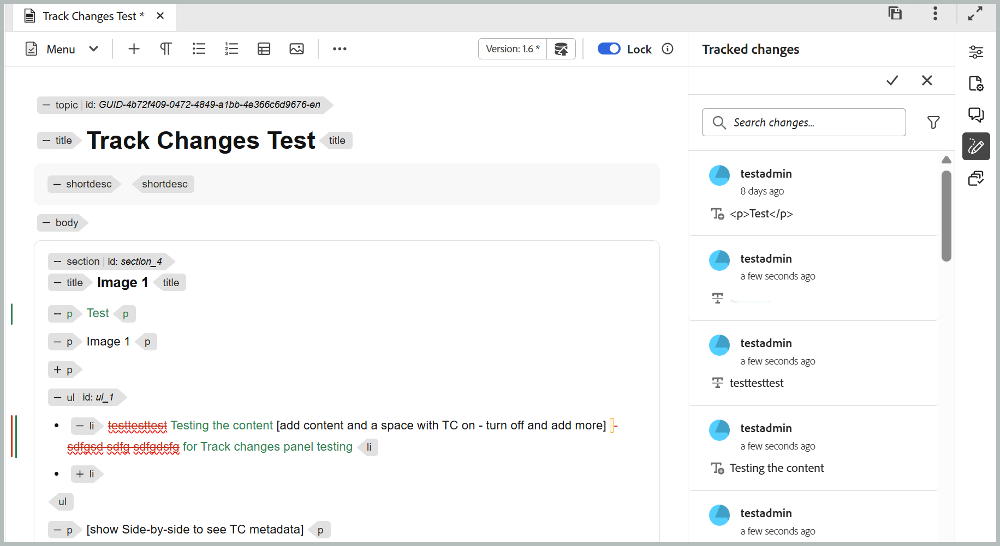
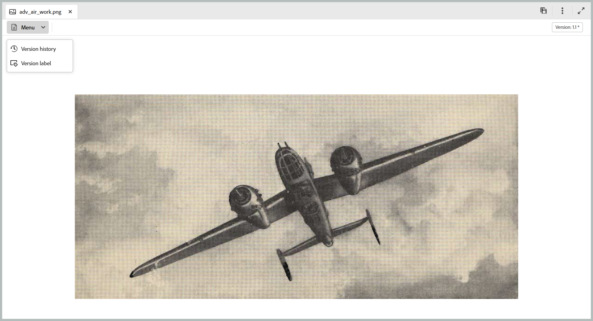

# 2026.11.0 リリース（2026年11月）の新機能

この記事では、Adobe Experience Manager Guides as a Cloud Serviceの2026.11.0 リリースで導入された新機能と強化機能について説明します。

このリリースで修正された問題のリストについては、[2026.11.0 リリース &#x200B;](fixed-issues-2026-11-0.md)で修正された問題を参照してください。

2026.11.0 リリース [&#128279;](../release-info/upgrade-instructions-2026-11-0.md)の アップグレード手順について説明します。

## マップレベルの分岐と結合の導入

Adobe Experience Manager Guidesでは、マップレベルの分岐と結合機能が導入されており、制作者はメインコンテンツに影響を与えることなく、複数のドキュメントバージョン、機能アップデート、クリティカルフィックスに並行して取り組むことができます。 作成者は、DITA マップとその依存関係の独立した分岐を作成して、編集、ロック、プレビューを各ブランチに固有のままにすることができます。

この機能により、ドキュメントチームは並行するワークストリームを管理し、効率的にコラボレーションして、メインドキュメントバージョンの安定性を維持できます。 以下の操作を実行できます。

- **DITA マップのメインバージョンから分岐**&#x200B;を作成して、機能、機能強化、または重要な修正を個別に作業します。
- **複数のドキュメント バージョンを管理するには、エディターの分岐**&#x200B;を切り替えます。
- **コンテンツのバージョンを管理**&#x200B;して、分岐と結合による変更を整理します。
- **ガイド付きの比較ワークフローと3方向の結合を使用して、結合の競合を解決**。
- **変更**&#x200B;をメインバージョンに結合します。
- **標準の公開を使用して、メインバージョンを変更せずにブランチ**&#x200B;から直接公開します。

[分岐と結合](../user-guide/branching-overview.md)について詳しく説明します。

{width="650"}

## AI アシスタントのAIを活用したコンテンツ制作とインポートスキル

>[!NOTE]
>
>エージェンティックモードでAI アシスタントを使用するには、組織をAdobe CX Enterprise Coworkerにオンボーディングし、必要なクレジットを取得している必要があります。

これで、**AI アシスタント**&#x200B;を使用して、自然言語プロンプトを使用してDITA コンテンツを作成および読み込むことができます。 **Adobe CX Enterprise Coworker**&#x200B;を活用した新しい&#x200B;**作成**&#x200B;および&#x200B;**読み込み** スキルは、構造化されたコンテンツ作成を簡素化し、DITAの広範な専門知識を必要とせずにDITA コンテンツを作業するのに役立ちます。

- **作成：** リポジトリーテンプレートを使用して、自然言語プロンプト、参照ドキュメント、または既存のコンテンツからDITA トピックとマップを生成します。 生成されたコンテンツを保存する前にレビューし、要件に合わせて新規または既存のコンテンツを繰り返し調整できます。
- **読み込み：**&#x200B;既存のPDF、DOCX、またはMarkdown ファイルを構造化されたDITA トピックとマップに変換します。 変換されたコンテンツは、リポジトリに保存する前にプレビューして確認できます。
- **スマートタグ：**&#x200B;組織の分類に基づいて、コンテンツに関連するタグの推奨事項を取得します。 強化されたエクスペリエンスにより、フォルダープロファイル管理者は、Workspace設定で分類の名前空間を設定でき、一貫性のある管理されたタグのレコメンデーションを実現できます。

**AI アシスタント** パネルでは、フルスクリーンモードと&#x200B;**アクティブな会話** セクションも導入され、会話体験を強化できます。

詳しくは、[&#x200B; エージェンティックモードでのAI アシスタントの使用](../user-guide/ai-assistant.md#agentic-mode)を参照してください。

{width="650"}

## Experience Manager Guidesの新しいヘルプアシスタントパネル

生成AIを活用した&#x200B;**スマートヘルプ**&#x200B;機能は、専用の&#x200B;**ヘルプアシスタント** パネルから利用できます。このパネルは、ホームページ、エディター、マップコンソールのインターフェイスからアクセスできます。 このパネルでは、会話型の検索エクスペリエンスを使用できます。自然言語で質問すると、Experience Manager Guides ドキュメントから関連情報をすばやく見つけることができます。 これにより、エディターを離れることなく、コンテクストに即したガイダンスにアクセスし、クエリを解決できるようになり、オーサリングワークフローが合理化されます。

管理者は、Workspace設定を使用して、ヘルプアシスタントパネルの利用状況を管理できます。 **AI ヘルプアシスタント** セクションには、ユーザーのパネルを有効または無効にするトグルが含まれています。

詳細については、[&#x200B; ヘルプアシスタント &#x200B;](../user-guide/ai-based-smart-help.md)を参照してください。

{width="650"}

## オーサリング機能

### 新規エディターでの変更履歴パネル

**変更履歴** パネルが新しいエディターで使用できるようになりました。これにより、トピック内のすべてのトラッキング済み挿入と削除を表示できます。 複数のユーザーによる編集を追跡し、パネルから直接変更を承認または却下できます。

また、削除されたコンテンツを取り消し線テキストとして表示したり、対応する変更にリンクされた鉛筆アイコンに置き換えたりできる&#x200B;**トラッキングされた削除をインラインで表示**&#x200B;設定を使用して、エディターで削除されたコンテンツを表示する方法を制御することもできます。 [変更履歴](../user-guide/config-editor-settings.md#track-changes)の詳細を確認します。

{width="650"}

### エクスプローラーパネルでのファイルとフォルダーの並べ替え

エディターの&#x200B;**Explorer** パネルでは、**並べ替え** ボタンを使用して、ファイルとフォルダーを昇順または降順で並べ替えることができます。 デフォルトでは、アイテムは、**ユーザー環境設定**&#x200B;の&#x200B;**エディターファイル表示**&#x200B;設定に基づいて、タイトルまたはファイル名で昇順に並べ替えられます。 これにより、エディター内のコンテンツを簡単に移動して見つけることができます。

詳しくは、「ファイルとフォルダーのページ分割による読み込み」の「[Explorer](../user-guide/paginated-loading-assets.md#explorer)」セクションを参照してください。

### エディターからDITA以外のファイルのバージョンとラベルを管理

Experience Manager Guidesを使用すると、画像、マルチメディア、ZIP、PDF、DOCX ファイルなど、DITA以外のファイルのバージョン履歴を表示したり、バージョンラベルをエディターから直接管理したりできます。 Assets UIに移動しなくても、これらのファイルをプレビューしたり、バージョン履歴を確認したり、バージョンを比較したり、以前のバージョンに戻したりできます。 また、既存のファイルバージョンのバージョンラベルを適用または更新して、バージョンの識別と管理を簡素化することもできます。

詳しくは、[&#x200B; メディアやその他のDITA以外のファイルの操作](../user-guide/authoring-file-management.md#work-with-media-and-other-non-dita-files)を参照してください。

{width="650"}

## 機能強化を見る

### イニシエータのコメントを使用したレビューの共同作業の強化

レビュー開始者は、レビューUIを使用して、レビュータスク内のトピックにインラインコメントや注釈を追加できます。 これにより、トピックを追加したり、特定のコンテンツをハイライト表示したり、フィードバックが必要な部分にレビュー担当者の注意を向けたりすることができます。

これらのコメントは、他のレビュー担当者からのフィードバックと共に&#x200B;**コメント** パネルに表示され、レビュー議論の全体像を提供します。 また、レビューアーは、イニシエーターがコメントを追加するとAEM通知を受け取り、レビュープロセス全体を通じてコラボレーションとコミュニケーションを合理化するのに役立ちます。 詳細については、[&#x200B; レビュー担当者のコメントを追加](../user-guide/review-send-topics-for-review.md#add-comments-for-reviewers)を参照してください。

## 公開の機能強化

### マップコンソールでの出力履歴の表示と管理

Experience Manager Guidesのマップコンソールに「**出力履歴**」タブが追加され、マップダッシュボードに移動することなく、エディターから直接出力生成タスクを表示および管理できるようになりました。

このタブには、ステータス、プリセットの詳細、生成日、期間など、出力生成タスクの統合ビューが表示されます。 タスクの検索とフィルタリング、進行中の生成のキャンセル、生成された出力とログへのアクセス、履歴からの完了したエントリの削除を行うことができます。 出力履歴をCSV ファイルとして書き出して、さらに分析することもできます。 出力生成ステータスでは、マップダッシュボードと一致するカラーインジケーターを使用します。

詳しくは、[出力生成プロセスの管理](../user-guide/generate-output-manage-process.md#view-and-manage-output-generation-tasks-from-the-editor)を参照してください。

{width="650"}

### 出力履歴のパージ オプションの強化

出力履歴&#x200B;**年齢別** （指定された日数より古いエントリを削除）または&#x200B;**カウント別** （指定された最近のエントリ数のみを保持）をパージできます。

また、監査目的で履歴エントリを保持しながら出力ログのみをパージするか、ログと関連するエントリの両方を削除することもできます。 これらのオプションは、出力履歴のパージをより詳細に制御しながら、リポジトリストレージを最適化するのに役立ちます。

詳細については、[出力履歴の自動削除期間の設定](../install-conf-guide/conf-output-generation.md#configure-auto-purging-period-for-output-history-id19aai070v8q)を参照してください。

### Edge Delivery Services公開プロファイルのGitLab サポート

Edge Delivery Services パブリッシングは、GitLabでホストされているリポジトリとGitHubをサポートしており、DITA コンテンツの管理と公開をより柔軟にします。 GitLabでホストされているサイトに公開するには、Edge Delivery Services公開プロファイルを作成する際にサーバータイプとして「GitLab」を選択し、「アクセストークン」フィールドにリポジトリのプロジェクトアクセストークンを指定します。

公開プリセットにはサブフォルダーのフィールドも含まれているため、プロファイルで指定したルートフォルダー内のサブフォルダーにコンテンツを公開できます。

詳しくは、[Edge Delivery Servicesの設定](../knowledge-base/publishing/configure-eds.md)を参照してください。

### Salesforce パブリッシングの機能強化

Experience Manager Guidesは、セキュリティ、パフォーマンス、公開の効率性を向上させ、Salesforceの公開機能を強化します。 これらの機能強化には、Code Exchangeのプルーフキー（PKCE）、トークンベースの認証の更新、記事レベルの公開ステータス、詳細な公開ログ、出力履歴、および冗長なアップロードを減らすための最適化されたアセット公開のサポートが含まれます。

詳しくは、「[&#x200B; バックエンド処理を使用した拡張Salesforce公開](../user-guide/web-editor-article-publishing.md#enhanced-salesforce-publishing-using-backend-processing)」を参照してください。

### Native PDFでのマップメタデータからの画像のサポート

PDFのネイティブ公開では、DITA マップ、ブックマップ、カスタムマップのメタデータで定義された画像の動的表示がサポートされています。 生成された出力では、製品カバー画像などのマップ固有の画像を表示しながら、複数のマップで1つのPDF テンプレートを使用できます。

画像プレースホルダーをページレイアウトに追加すると、公開中にマップメタデータで参照される画像を自動的に入力できます。 これにより、異なる画像用に別々のテンプレートを管理する必要がなくなり、テンプレート管理が簡素化されます。

詳しくは、[&#x200B; マップメタデータから画像を追加](../native-pdf/design-page-layout.md#add-an-image-from-map-metadata-add-image-map-metadata)を参照してください。

### 古いエディターのコンテンツのヘルスチェックでコンテンツの品質を検証する

コンテンツのヘルスチェックは古いエディター（既に新しいエディターでサポート）で利用でき、公開前にDITA マップ全体でコンテンツ品質を検証するのに役立ちます。 管理者は、壊れたリンク、重複ID、Schematron検証のチェックを組み合わせることで、再利用可能なヘルスチェックプリセットを作成できます。

作成者は、DITA マップまたは古いエディターで選択したベースラインでヘルスチェックを実行して、関連するトピックとマップ間の問題の統合レポートを生成できます。 詳しくは、[&#x200B; マップ上でヘルスチェックを実行](../user-guide/map-editor-other-features.md#run-health-check-on-a-map)を参照してください。

## レガシーコンテンツ移行用のUpsert API

このAPIを使用すると、単一のAPIを介してコンテンツとそのメタデータを作成または更新できます。 リクエストでのトピックコンテンツ、メタデータ、GUIDの指定をサポートしています。 APIは、`/bin/guides/v1/asset/upsert/`のSwagger API ドキュメントで利用できます。