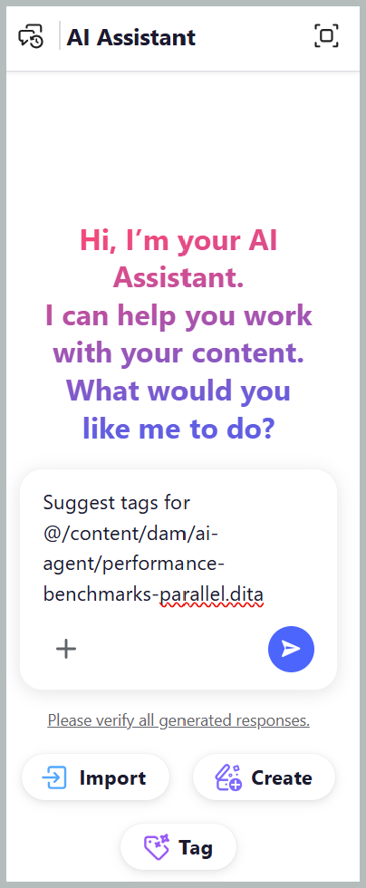
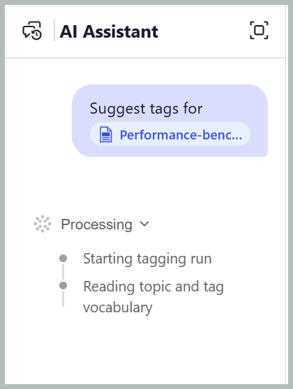

# AI アシスタントを使用したスマートタグ

Adobe CX Enterprise CoworkerのAI アシスタントのエージェンティックモードで利用できるスマートタグ付けスキルにより、コンテンツへのタグ付けをより早く、簡単に、より一貫性を持たせることができます。 コンテンツを分析し、組織の分類基準にもとづいて関連タグを推奨するため、コンテンツを手作業でレビューして該当するタグを特定する必要がなくなります。 管理者は、ワークスペースに関連する名前空間を選択することで、[Workspace settings](../install-conf-guide/workspace-settings.md#general)を通じてタグの推奨事項を生成するために使用される分類を設定できます。

提案されたタグを確認し、選択を確認する前に適用または却下することを選択することで、コントロールを維持できます。 これにより、手作業を削減し、タグ付けの正確性を向上させ、ドキュメント全体で一貫性のあるメタデータを維持することができます。

## スマートタグ機能を使用して、単一または複数のトピックにタグを適用できます

スマートタグ付けスキルを持つ単一または複数のトピックにタグを適用するためにAI アシスタントを使用するには、次の手順を実行します。

1. Experience Manager Guidesにログインします。
1. ホームページで、ナビゲーションバーから「**AI Assistant**」を選択します。 エージェント モード ](../install-conf-guide/workspace-settings.md)の[AI アシスタントが管理者によって有効になっていることを確認してください。
1. 次のいずれかの方法を使用して、タグのレコメンデーションを生成するトピックを追加します。

   - **提案されたプロンプトを使用**：応答領域の最初のチャットでは、ファイル **プロンプトに**&#x200B;提案タグを選択します。 プロンプトがプロンプトスペースに自動的に追加されます。 `[file]`を選択し、**ファイルを選択** ダイアログでリポジトリまたはコレクションからトピックを選択します。 **ファイルを選択** ダイアログから1つのトピックを選択できます。

     {width="650"}

   - **ショートカットを使用**:「`/`」をプロンプト フィールドに入力し、**リポジトリ参照を追加**」を選択してリポジトリからトピックを選択し（または&#x200B;**デバイスからファイルを追加**、コンピューターからトピックをアップロード）、*ファイルのタグを提案*&#x200B;などのプロンプトを入力します。

   - **ドラッグ&amp;ドロップ**:1つのトピックまたは複数のトピックをプロンプトスペースにドラッグ&amp;ドロップし、*ファイルのタグを提案*&#x200B;などのプロンプトを入力します。

     {width="650"}

   - **トピックパスを指定**:「`@`」と入力し、その後に、同じマップまたは異なるマップの複数のトピックのコンマ区切りパスを入力し、*ファイルのタグの候補*&#x200B;などのプロンプトを入力します。

     {width="650"}

1. **送信**&#x200B;を選択します。

1. AI アシスタントがトピックのコンテンツを分析し、タグのレコメンデーションを生成します。

   分析と思考中の{width="650"}

1. 次のように、提案されたタグを確認します。

   >[!NOTE]
   >
   > 既にタグが含まれているトピックの場合、AI アシスタントは既存のタグを表示します。 これらのタグは読み取り専用で、変更または削除できません。

   - 1つのトピックに対して、推奨事項を&#x200B;**受け入れる**&#x200B;か、必要でない場合は&#x200B;**拒否**&#x200B;できます。

     コンテンツの分析後の{width="650"}

   - 複数のトピックの場合：
     1. AIが生成したタグのレコメンデーションを確認するには、**プレビュー**&#x200B;を選択します。

        {width="650"}

     1. 各トピックの推奨タグを確認し、次のいずれかのアクションを選択します。
        - **すべて受け入れる**&#x200B;を選択して、すべてのトピックに推奨されたタグを適用します。
        - **すべてのトピックに対して提案されたタグをすべて破棄するには、**&#x200B;をすべて却下します。
        - 特定のトピックに対するすべての提案タグを削除するには、**すべての提案をクリア**&#x200B;します。
        - タグの横にある&#x200B;**X** アイコンを選択して、個々のタグの候補を削除します。

          {width="650"}

1. 提案されたタグを受け入れると、スマートタグのスキルによって、AIが生成したタグが、コンテンツに既に適用されているタグに追加されます。

レビューが完了すると、AI アシスタントにトピックに適用されたタグの概要と、拒否されたタグのレコメンデーションが表示されます。

{width="650"}

## スマートタグスキルを使用して、マップの複数のトピックにタグを適用する

スマートタグ付けスキルを使用してマップの複数のトピックにタグを適用するためにAI アシスタントを使用するには、次の手順を実行します。

1. Experience Manager Guidesにログインします。
1. ホームページで、ナビゲーションバーから「**AI Assistant**」を選択します。 エージェント モードのAI アシスタントが管理者によって有効になっていることを確認します。
1. トピックで説明されているように、次のいずれかの方法を使用して、タグのレコメンデーションを生成するマップを追加します。

   - **提案されたプロンプトを使用**：応答領域の最初のチャットでは、ファイル **プロンプトに**&#x200B;提案タグを選択します。 プロンプトがプロンプトスペースに自動的に追加されます。 `[file]`を選択し、**ファイルを選択** ダイアログでリポジトリまたはコレクションからマップを選択します。

   - **ドラッグ&amp;ドロップ**：マップをプロンプト スペースにドラッグ&amp;ドロップし、*ファイルのタグを提案*&#x200B;などのプロンプトを入力します。

   - **ショートカットを使用**:「`/`」をプロンプト フィールドに入力し、**リポジトリ参照を追加**」を選択してリポジトリからマップを選択し（または&#x200B;**デバイス**&#x200B;からファイルを追加してコンピューターからマップをアップロード）、*ファイルのタグを提案*&#x200B;などのプロンプトを入力します。

     {width="650"}

1. **送信**を選択します。
選択したマップに複数のトピックが含まれていることを示すメッセージ。 「**トピックを選択**」を選択して、タグのレコメンデーションの対象となるトピックを選択します。

   {width="650"}

1. **トピックを選択** ダイアログで、タグのレコメンデーションの対象となるトピックを選択します。\
   **トピックを選択** ダイアログには、次の情報が表示されます。

   - **トピックリスト：**&#x200B;選択したマップ内のすべてのトピックを表示します。 タグのレコメンデーションを生成するトピックを選択します。
   - **プレビューペイン：**&#x200B;選択したトピックのプレビューを、既存のタグと共に表示します。
   - **フィルター：** **タグが追加されたトピックのみを表示するようにトピックをフィルター処理します**&#x200B;または&#x200B;**タグが追加されていない**。

     {width="650"}

1. 「**確認**」を選択します。 AI アシスタントは、選択したトピックを分析し、各トピックに対して生成されたタグレコメンデーションの数を表示します。
1. AIが生成したタグのレコメンデーションを確認するには、**プレビュー**&#x200B;を選択します。
1. 各トピックの推奨タグを確認し、次のいずれかのアクションを選択します。
   - **すべてのトピックに対して提案されたすべてのタグを適用するには、**&#x200B;を承認してください。
   - すべてのトピックに対して提案されたすべてのタグを破棄するには、**却下**&#x200B;してください。
   - 特定のトピックに対するすべての提案タグを削除するには、**すべての提案をクリア**&#x200B;します。
   - タグの横にある&#x200B;**X** アイコンを選択して、個々のタグの候補を削除します。

     >[!NOTE]
     >
     > 既にタグが含まれているトピックの場合、AI アシスタントは既存のタグを表示します。 これらのタグは読み取り専用で、変更または削除できません。

   {width="650"}

1. 提案されたタグを受け入れると、スマートタグ付けスキルは、AIが生成したタグを、コンテンツに既に適用されているタグに追加します。

レビューが完了すると、AI アシスタントに、各トピックに適用されたタグの概要と、拒否されたタグレコメンデーションが表示されます。

