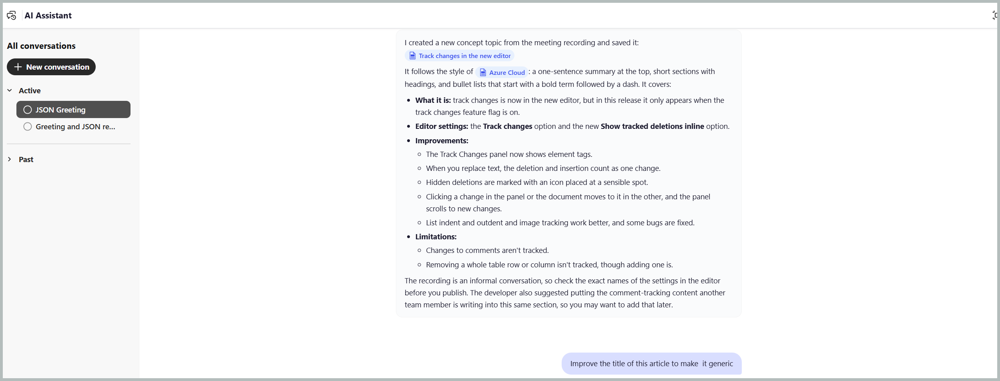
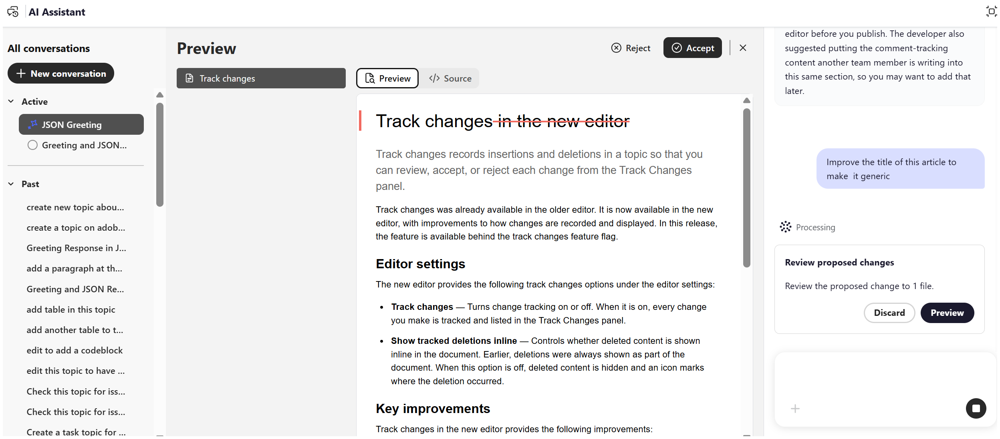

# コンテンツの最初のドラフトを作成

AI アシスタントのエージェント モードの&#x200B;**作成** スキルは、メモ、仕様、ホワイトボード画像、スクリーンショット、またはその他の利用可能な参考資料から構造化コンテンツの最初のドラフトを生成するのに役立ちます。 このスキルは、リポジトリで利用可能なコンテンツとトピックテンプレートに基づいて、コンセプト、タスク、参照、トラブルシューティングなどの適切なDITA トピックタイプを自動的に識別し、コンテンツの構築とオーサリングに必要な手作業を削減します。

ファイルを添付し、トーンとスタイルの参照として既存のファイルを選択し、生成されたコンテンツを保存するフォルダーを指定できます。 目的のコンテンツの最初のドラフトを作成するには、次の手順に従います。

1. Experience Manager Guidesにログインします。
1. ホームページで、ナビゲーションバーから「**AI Assistant**」を選択します。 エージェント モード ](../install-conf-guide/workspace-settings.md)の[AI アシスタントが管理者によって有効になっていることを確認してください。

1. AI アシスタントパネルから「**作成**」を選択します。

   スタータープロンプトがプロンプトボックスに表示されます。*添付ファイルを参照し、[ ファイル]*&#x200B;と類似したコンテンツのトーンを持つ下書きコンテンツを作成します

1. 次のいずれかの方法を使用して、メモ、仕様、またはその他の参照ファイルをプロンプトに添付します。

   - **ショートカットを使用**:「プロンプト」フィールドに「`/`」と入力し、「**リポジトリ参照を追加**」を選択してリポジトリからファイルを選択します（または&#x200B;**デバイスからファイルを追加**、コンピューターからファイルをアップロード）。

   - **ファイルの添付またはコンテキストアイコン（+）**&#x200B;を使用：ローカルシステムからファイルを追加します。

   - **ドラッグ&amp;ドロップ**: ドラフトするファイルをシステムから直接プロンプト領域にドラッグ&amp;ドロップします。

1. *（オプション）* スタータープロンプトで、`[file]`を選択します。 下書きのトーンを一致させる既存のトピックを選択します。 リポジトリまたはコレクションからトピックを選択できます。 プロンプトのトピック名が`[file]`に置き換わります。

   {width="650"}

1. **送信**&#x200B;を選択します。

   AI アシスタントはコンテンツを分析し、完了した各ステップをリストアップします。

1. AI アシスタントからのフォローアップの質問に答え、コンテンツの生成に必要な詳細を提供します。

   {width="650"}

1. 生成されたトピックをレビューするには、**プレビュー**&#x200B;を選択します。

   各ドラフトをソース資料と要求したトピックタイプに照らし合わせて確認します。

   

1. 次のいずれかを選択します。

   - **承認**&#x200B;して、確認したフォルダーにトピックを保存します
   - 何も保存せずに変更を破棄するには、**却下**&#x200B;してください。 ドラフトコンテンツを却下する理由を指定し、必要な変更を指定するプロンプトを入力できます。 AI アシスタントがフィードバックを使用して、コンテンツのドラフトを修正します。

     トピックがリポジトリで利用できるようになりました。

     

AI アシスタントがトピックを作成した後、それをエディターで開き、フォローアッププロンプトを使用してコンテンツを調整できます。 これにより、新しい会話を開始することなく、トピックを繰り返し改善することができます。 提案された変更はそれぞれ、**変更履歴**&#x200B;が有効になっているプレビューに表示され、変更を適用する前に変更を確認できます。

例えば、生成されたトピックのタイトルを絞り込むには、次のようにします。

1. AI アシスタントダイアログから、エディターで新しく作成したトピックを開きます。

   

1. AI アシスタントパネルに、`Improve the title of this topic to make it generic.`などのフォローアッププロンプトを入力します

   

1. **送信**&#x200B;を選択します。

   AI Assistantが分析し、新しいタイトルを提案します。

1. **プレビュー**&#x200B;を選択して、提案された変更を確認します。

   プレビューには、変更履歴が追跡されたタイトルが表示され、変更内容がハイライト表示されます。

   

1. トピックに変更を適用するには、**同意**&#x200B;を選択します。

   

同じ会話で追加のプロンプトを提供することで、段落、手順、表など、トピックの他の要素を引き続き調整できます。

