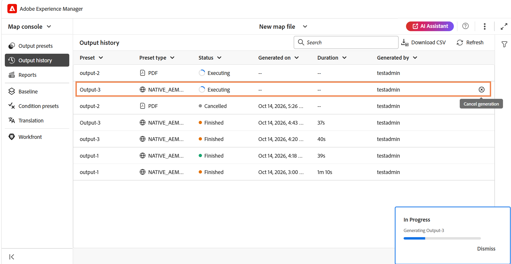
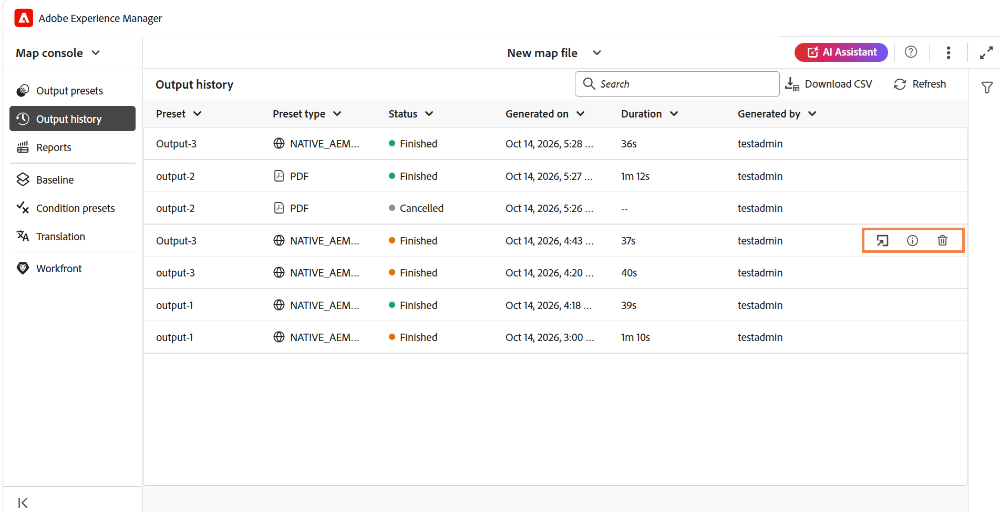
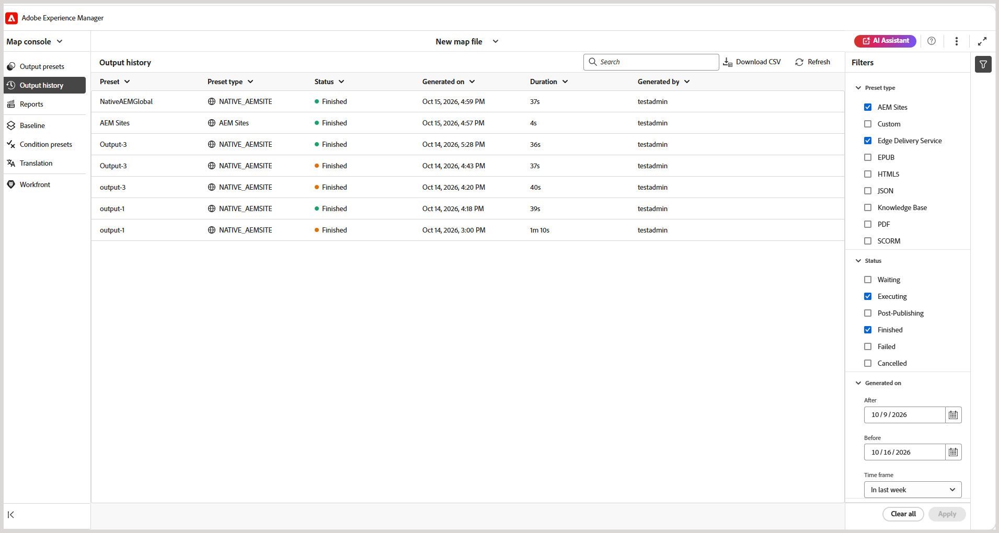
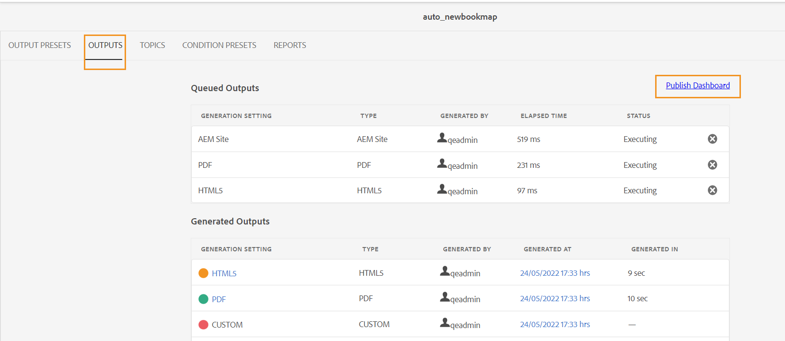
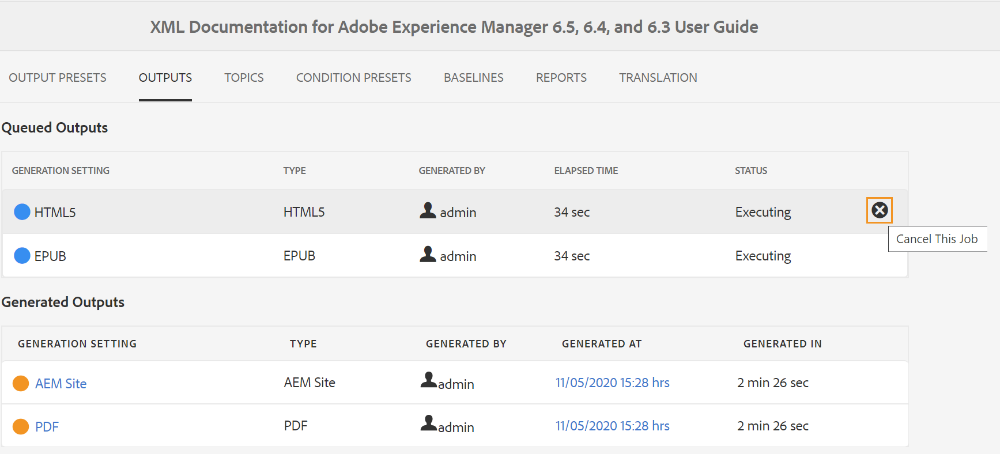
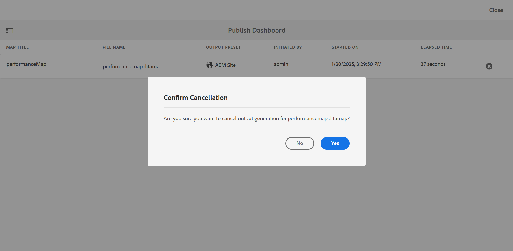
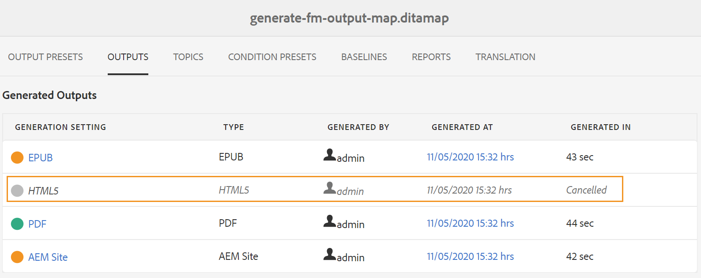
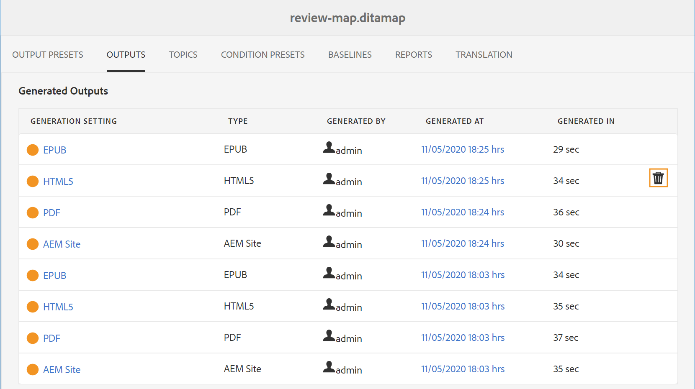

# 出力生成プロセスの管理

Adobe Experience Manager Guidesでは、DITA マップの出力生成タスクをモニターおよび管理できます。 出力生成タスクのステータスを表示したり、進行中のタスクをキャンセルしたり、出力生成履歴から古いエントリを削除したりできます。

マップの出力生成タスクを開始するか、選択したトピックを再生成すると、Experience Manager Guidesは出力生成キューにタスクを送信します。 タスクのステータスは、出力生成プロセスの進行状況に応じて更新されます。

出力生成タスクは、エディターの「**出力履歴**」タブまたはAssets UIの「**出力**」タブを使用して表示および管理できます。

## エディターでの出力生成タスクの表示と管理

出力生成タスクは、マップコンソールの「**出力履歴**」タブから直接表示および管理できます。

マップコンソールでDITA マップを開き、Experience Manager Guidesで使用可能な出力プリセットを使用して出力を生成します。 次に示すように、**出力履歴** タブに切り替えて、出力生成タスクのステータスやその他の詳細を表示します。

出力生成タスクごとに、次の情報を表示できます。

1. **プリセット：**&#x200B;出力の生成に使用する出力プリセットの名前。
1. **プリセットタイプ：**&#x200B;出力生成に使用される出力プリセットタイプ。
1. **ステータス：**&#x200B;出力生成タスクの現在のステータス（待機中、実行中、完了、失敗、公開後、キャンセル済みなど）。
1. **生成日：**&#x200B;出力が生成された日時。
1. **期間：**&#x200B;出力の生成にかかる時間。
1. **によって生成：**&#x200B;出力生成タスクを開始したユーザーの名前。

>[!NOTE]
>
> 出力生成タスクが現在進行中の場合、**ステータス**&#x200B;列の&#x200B;**実行** ラベルは、タスクが処理中であることを示します。 出力生成タスクの最新のステータスを表示するには、**更新**&#x200B;を使用します。

また、進行中の出力生成タスクをキャンセルすることもできます。 進行中のタスクをキャンセルするには、タスク行にカーソルを合わせて、**生成をキャンセル**&#x200B;を選択します。

タスクがキャンセルされると、**キャンセル済み** ラベルが&#x200B;**ステータス**&#x200B;列に表示されます。

完了した出力生成タスクの場合は、タスク行にカーソルを合わせて、タスクのステータスに応じて次のアクションにアクセスします。

- **出力を開く：**&#x200B;生成された出力を新しいタブで表示します。
- **ログを表示：**&#x200B;出力生成ログにアクセスして、公開の詳細を確認し、エラーまたは警告をトラブルシューティングします。
- **出力履歴を削除：**&#x200B;生成された出力を削除せずに、選択したタスクを出力生成履歴から削除します。

次のオプションを使用して、出力生成履歴を操作することもできます。

- **検索：**&#x200B;検索フィールドを使用して、履歴内の特定の出力生成タスクを検索します。
- **CSVをダウンロード：** **CSVをダウンロード**&#x200B;を選択して、出力生成履歴をCSV形式でダウンロードします。
- **列のサイズ変更：**&#x200B;列名の横にあるドロップダウンを選択し、**列のサイズ変更**&#x200B;を選択して列の幅を調整します。
- **フィルター**：出力プリセットの種類、タスクの状態、日付と時間範囲に基づいてフィルターを適用し、出力生成履歴を絞り込みます。

  

また、各タスクのステータスは、色分けされたアイコンで示されます。成功したタスクは緑、メッセージで完了したタスクはオレンジ、失敗したタスクは赤です。 これにより、注意が必要なタスクを素早く特定できます。

## Assets UIからの出力生成タスクの表示と管理

Assets AIを使用すると、生成された出力に対して次のアクションを実行できます。

- [出力生成タスクのステータスを表示](#view-the-status-of-the-output-generation-task)
- [出力生成タスクのキャンセル](#cancel-an-output-generation-task)
- [出力タスクの削除](#delete-an-output-task)

### 出力生成タスクのステータスの表示

マップの出力生成タスクを開始するか、選択したトピックを再生成すると、Experience Manager Guidesはこのタスクを出力生成キューに送信します。 このキューはリアルタイムで更新され、キュー内の各出力生成タスクのステータスが表示されます。

1. Assets UIで、出力生成ステータスを確認するマップファイルに移動して開きます。

1. **出力**&#x200B;を選択します。

   

   出力ページは、次の2つの部分に分かれています。

   - **キューに入れた出力：**

     生成待ち、または生成処理中の出力を一覧表示します。 キュー内または処理中のタスクは、プリセット名の前に青いカラーアイコンで表示されます。 また、キューに入れられたタスクに使用される出力生成設定またはプリセット、タイプ、タスクを開始したユーザー、タスクがキューに入れてからの時間、および現在のステータスを確認することもできます。

     リンクを選択して&#x200B;**公開ダッシュボード**&#x200B;にアクセスし、現在の実行中のステータスを表示します。 アクティブなすべての公開タスクのリストは、公開ダッシュボードで使用できます。 **キュー出力**&#x200B;と&#x200B;**公開ダッシュボード** リンクは、生成待ちまたは生成処理中の出力がある場合にのみ表示されます。 出力タスクが完了した場合は表示されません。公開ダッシュボードについて詳しくは、[公開ダッシュボードを使用して公開タスクを管理](generate-output-publish-dashboard.md#)を参照してください。

   - **生成された出力**

     完了した出力タスクが一覧表示されます。 ここでも、ここに示す情報は、キュー出力セクションと似ていますが、いくつかの違いがあります。 出力結果アイコンと出力生成時間の形式で新しい情報セットが用意されています。

     このリストには、正常に実行されたタスク、メッセージで実行されたタスク、失敗したタスクがある場合があります。 成功したタスクは緑色のアイコンで表示され、メッセージを含むタスクにはオレンジ色のアイコンが表示され、失敗したタスクには赤色のアイコンが表示されます。

     すべてのタスクに対して、公開プロセスによってログファイル \（logs.txt\）が作成されます。このログファイルには、**生成日時**&#x200B;列のリンクを選択してアクセスできます。 失敗したタスクやメッセージがあるタスクについては、ログファイルを確認できます。ログファイルについては、[表示とログファイルの確認](generate-output-basic-troubleshooting.md#id1822G0P0CHS)で説明しています。

     >[!NOTE]
     >
     > 生成されたPDF出力のリンクを選択すると、PDFのダウンロードを求められます。

### 出力生成タスクのキャンセル

Experience Manager Guidesを使用すると、パブリッシャーは進行中の公開タスクをキャンセルするシンプルで簡単な方法を入手できます。 パブリッシャーは、DITA マップコンソールまたは[公開ダッシュボード ](generate-output-publish-dashboard.md#)から進行中の公開タスクをキャンセルできます。

DITA マップコンソールから出力生成タスクをキャンセルするには、次の手順を実行します。

1. Assets UIで、進行中の出力生成タスクをキャンセルするマップファイルに移動して開きます。

1. **出力**&#x200B;を選択します。

1. **キュー出力** リストで、キャンセルするタスクにポインターを合わせます。

1. 「**このジョブをキャンセル**」アイコンを選択します。

   

1. **解約を確認** メッセージ プロンプトで「**はい**」を選択します。

   

   タスクがまだ開始されていない場合は、そのタスクに対してキャンセル コマンドが実行されます。 キャンセル中のタスクの場合、ステータスはキャンセルに設定されます。

   タスクが正常にキャンセルされると、タスクは&#x200B;**キャンセル済み**&#x200B;のステータスで&#x200B;**生成出力** リストに移動されます。 キャンセルされたタスクにカーソルを合わせると、タスクをキャンセルしたユーザーの名前が表示されます。 次のスクリーンショットでは、*HTML5* タスクがキャンセルされています。

   

### 出力タスクの削除

DITA マップに対して複数の出力を生成すると、そのマップの「生成出力」リストが非常に長くなります。 発行者は、*生成出力* リストから古いタスクを削除することで、任意のマップファイルの出力履歴をクリーニングできます。 出力はシステムから削除されませんが、生成された出力のエントリのみが&#x200B;*生成出力* リストから削除されます。

次の手順を実行して、生成された出力リストから出力タスクを削除します。

1. Assets UIで、タスクを削除するマップファイルに移動して開きます。

1. **出力**&#x200B;を選択します。

1. **生成出力** リストで、削除するタスクにポインターを合わせます。

1. 削除アイコンを選択します。

   

1. 「**削除を確認**」メッセージプロンプトで「**はい**」を選択します。

   タスクは、生成出力リストから削除されます。

