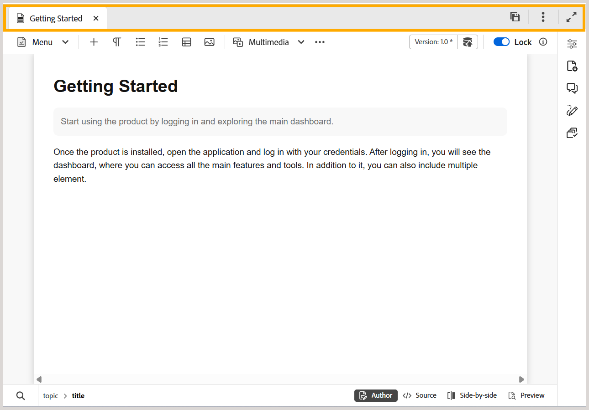
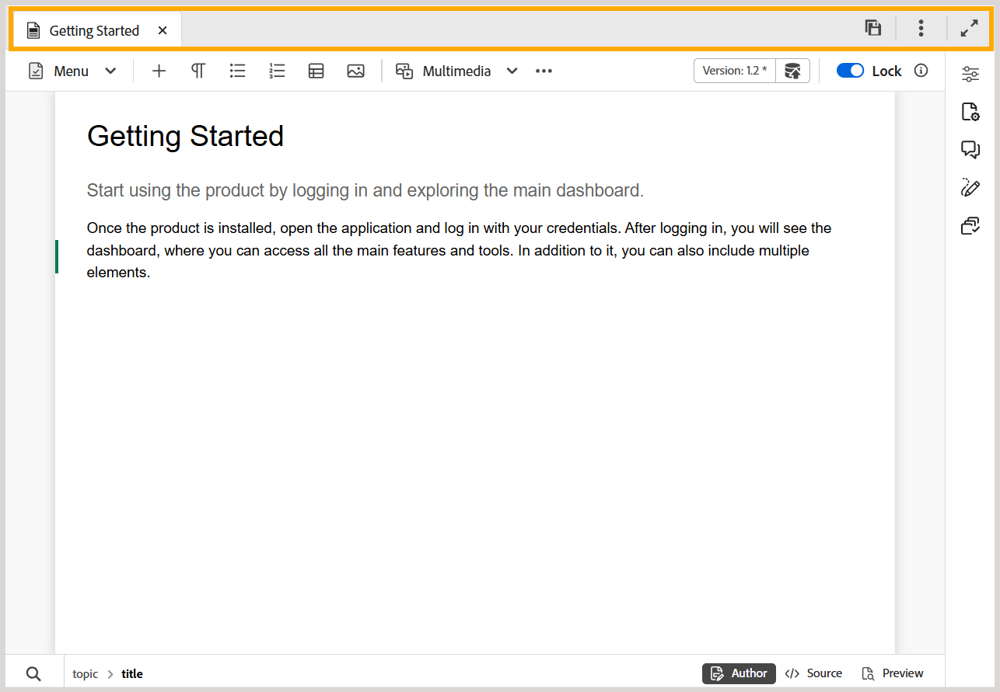

# エディターのタブバー

>[!INFO]
>
> このトピックは、新しいエディターと古いエディターの両方に適用されます。 コア機能は一貫していますが、ユーザーインターフェイス、用語、インタラクションの違いは、該当する場合はタブとコールアウトを使用してコンテンツ内に示されます。

タブバーはエディターのインターフェイスの上部にあり、様々なファイルレベルの機能にアクセスできます。

>[!BEGINTABS]

>[!TAB 新しいエディター]

>[!TAB 古いエディター]

>[!ENDTABS]

**タブ**

エディターで現在開いているトピックをファイルタブとして表示します。 複数のトピックを同時に開くことができ、これらはタブバーのそれぞれのタブに表示されます。 デフォルトでは、タブでファイルタイトルを表示できます。 ファイルにカーソルを合わせると、ファイルタイトルとファイルパスがツールチップとして表示されます。

>[!NOTE]
>
> 管理者は、タブ内のファイル名でファイルのリストを表示することもできます。 [&#x200B; ユーザー設定](./intro-home-page.md#user-preferences)の「**エディターファイル表示設定**」セクションで「**ファイル名**」オプションを選択します。

「ファイル」タブを選択すると、「新しいバージョンとして保存」、「コピー」、「検索」、「追加先」、「プロパティ」、「分割」、「PDFとしてダウンロード」、「閉じる」オプションを備えたコンテキストメニューが開きます。

**すべて保存**

開いているすべてのトピックで行った変更を保存します。 エディターで複数のトピックを開いている場合、**すべて保存**&#x200B;を選択するか、**Ctrl**+**S** ショートカットキーを使用すると、すべてのドキュメントをワンクリックで保存できます。 各ドキュメントを個別に保存する必要はありません。

>[!NOTE]
>
> **すべて保存**&#x200B;操作では、トピックの新しいバージョンは作成されません。 新しいバージョンを作成するには、**新しいバージョンとして保存** オプションを使用します。

**AI アシスタント**: AI アシスタントは、**Agentic**&#x200B;と&#x200B;**Standard**&#x200B;の2つのモードで利用できます。

>[!NOTE]
>
> お客様の環境でAI アシスタント機能のエージェンティックモードを使用する場合は、カスタマーサクセス部門にお問い合わせください。 この機能を有効にした後、管理者はWorkspaceの設定から有効または無効にできます。 AI アシスタントのモードは、エージェント型または標準のどちらか1つしか有効にできません。

- **エージェント**: AI アシスタントのエージェント モードでは、自然言語のインタラクションを通じてコンテンツ関連のタスクを実行できます。 チャットパネルで要件を説明し、AI アシスタントがタスクを計画および実行しながら、その進行状況を可視化できます。 デバイスやコンテンツリポジトリからPDF、Word、Markdown ファイルを構造化されたトピックに変換する「インポート」や、要件に基づいて新しいトピックを生成し、トーンやスタイルのために既存のコンテンツを参照する「作成」、メタデータの一貫性を向上させるために、組織の分類法にもとづいて関連タグを推奨する「スマートタグ」などのスキルに対応しています。

- **Standard**: スマートヘルプ機能を使用して生産性を向上させるように設計された、AIを活用した強力なツールです。 さらに、エディターのインターフェイスで作業する際には、AI アシスタントのスマートオーサリング機能を活用できます。これにより、コンテンツの再利用と最適化に関するインテリジェントな提案を通じて、オーサリングプロセスをよりスマートかつ迅速におこなうことができます。

[AI アシスタント &#x200B;](./ai-assistant.md)機能は現在、Adobe Experience Manager as Cloud Serviceでのみ使用できます。

**ヘルプアシスタント**: Experience Manager Guidesの&#x200B;**ヘルプアシスタント**&#x200B;は、生成AIを活用した会話型検索機能で、商品の機能、ワークフロー、トラブルシューティングに関する情報を検索できます。 Experience Manager Guidesのドキュメントにもとづいた回答の提供、フォローアップでの質問のサポート、参照用のソース記事へのリンクが含まれています。 詳しくは、[&#x200B; ヘルプアシスタントを使用した効率の向上](./ai-based-smart-help.md)を参照してください。

**ビューを展開**: **展開** アイコンを使用してページビューを展開できます。 このビューでは、Adobe Experience Manager ロゴを含むヘッダーバーは非表示になっています。 これにより、編集のためのコンテンツスペースが最大化されます。 標準ビューに戻るには、**拡張ビュー**&#x200B;を終了アイコンを使用します。

**その他のアクション**：追加のオプションへのアクセスを提供します。 このボタンを選択すると、次のオプションを含むメニューが開きます。

- **Assets**：設定に基づいて宛先に移動します。
  - **Cloud Services**: Cloud Servicesを使用している場合、**Assets** オプションを選択すると、AEM ナビゲーション ページに移動します。

  - **オンプレミスソフトウェア**: Adobe Experience Manager Guides（4.2.1以降）を使用している場合、**Assets** オプションを選択すると、Assets UIの現在のファイルパスに移動します。
- **Workspace settings**: Workspace settings ダイアログに移動します。 詳しくは、[Workspace設定の設定](../install-conf-guide/workspace-settings.md)を参照してください。

>[!NOTE]
>
>バージョン 5.2より前のオンプレミス設定でAdobe Experience Manager Guidesを使用している場合、Workspace設定オプションは、その他のアクション メニューの下に&#x200B;**Settings**&#x200B;として引き続き表示されます。

- **エディター設定**: エディター設定ダイアログに移動し、個々の作成者レベルでエディターの動作をカスタマイズできます。 オーサリング時に、タグ、コメント、その他のエディターレベルの設定の表示と動作を制御できます。 詳しくは、[&#x200B; エディター設定](../user-guide/config-editor-settings.md)を参照してください。

**親トピック：**&#x200B;[&#x200B; エディターの概要](web-editor.md)
